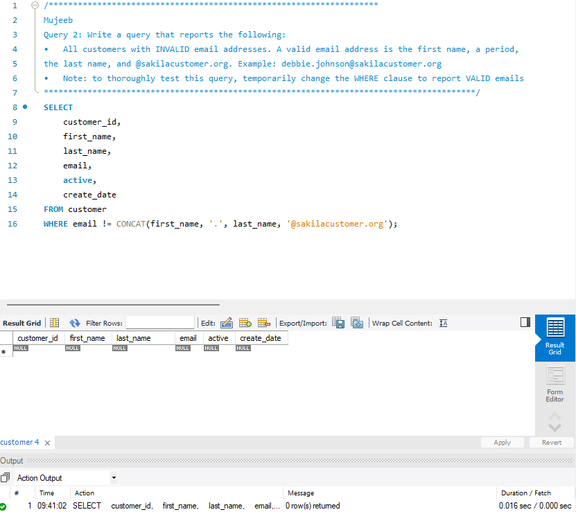
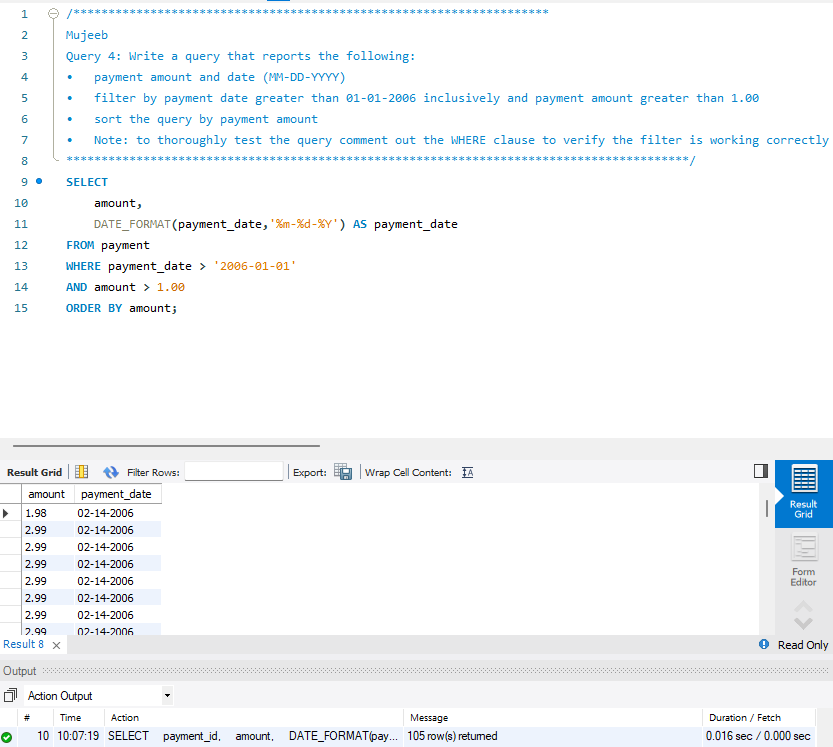
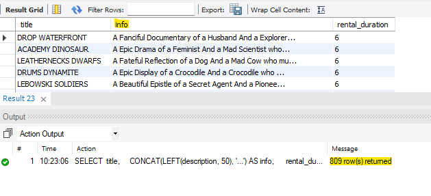
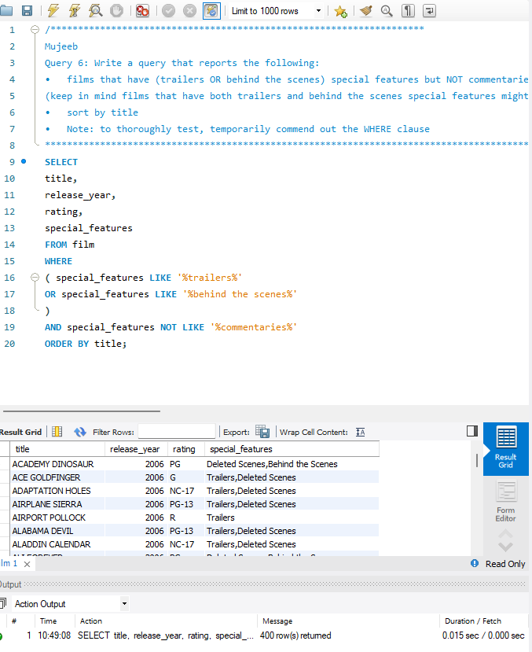
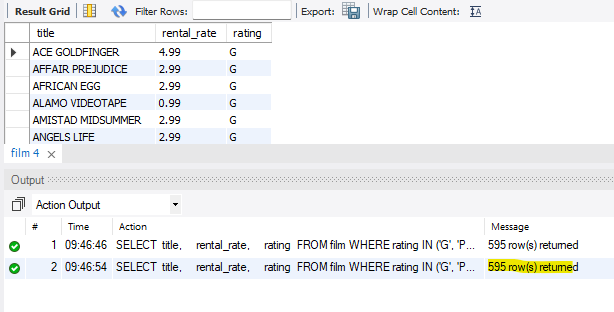
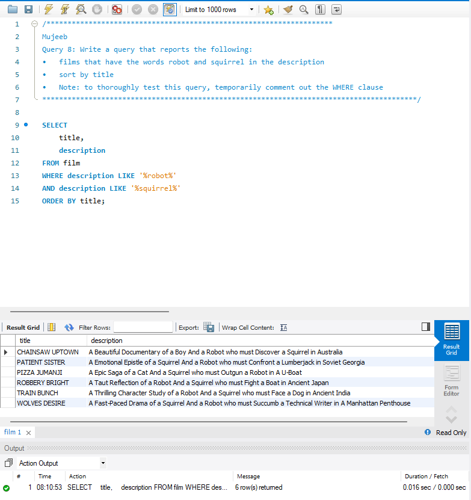
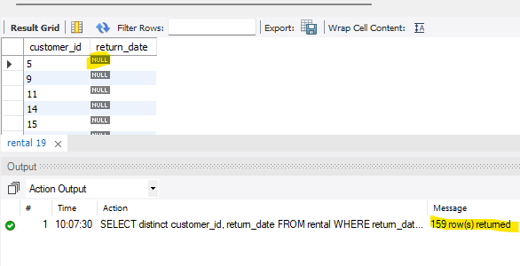
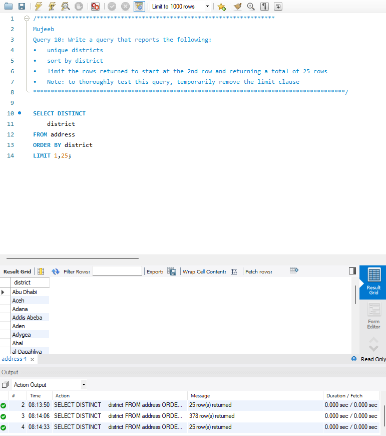

# MySQL_Chapter3.
<b>Table of Content</b>
- [Summary](#summary)
- [Collaborators](#collaborators)
- [New Concepts Used](#list-of-new-concepts-used)
- [Console Output Example](#console-output-testing-as-images)

## Summary
This assignment is a collection of ten single table queries that deal with data such as customer, 
film, rental information etc. In each query we manipulated how the data in the tables 
is displayed by using concepts listed in the following section.

## List of New Concepts Used 
- SELECT statements
- DISTINCT
- LIMIT
- CONCAT
- LEFT 
- ROUND 
- CURRENT_DATE 
- DATE_FORMAT
- WHERE
- LIKE 
- NOT LIKE
- ORDER BY 
- ASC and DESC

## console output testing as images
### Query 1

### Query 2

### Query 3

### Query 4

### Query 5

### Query 6

### Query 7

### Query 8

### Query 9

### Query 10

## Collaborators
**Mujeeb Adewuyi**   
GitHub: [@Yamujeeb](https://github.com/Yamujeeb)

**Suna Aregay**  
GitHub: [@suna2km](https://github.com/suna2km)
