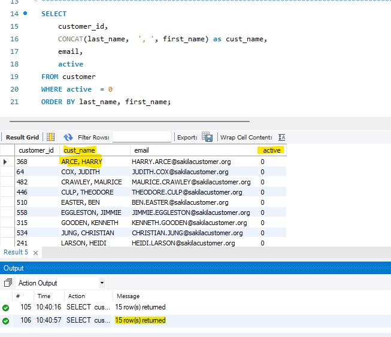
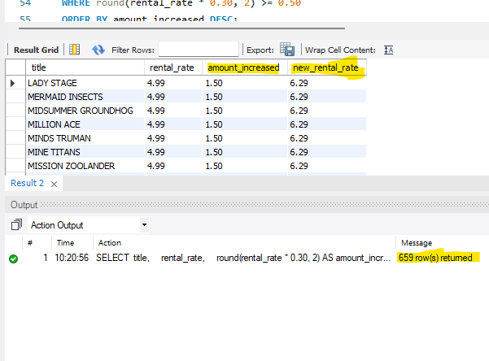

# MySQL_Chapter3.
## Sample Output
### Query 1

### Query 2

### Query 3

### Query 4

## Collaborators
**Mujeeb Adewuyi**   
GitHub: [@Yamujeeb](https://github.com/Yamujeeb)

**Suna Aregay**  
GitHub: [@suna2km](https://github.com/suna2km)
